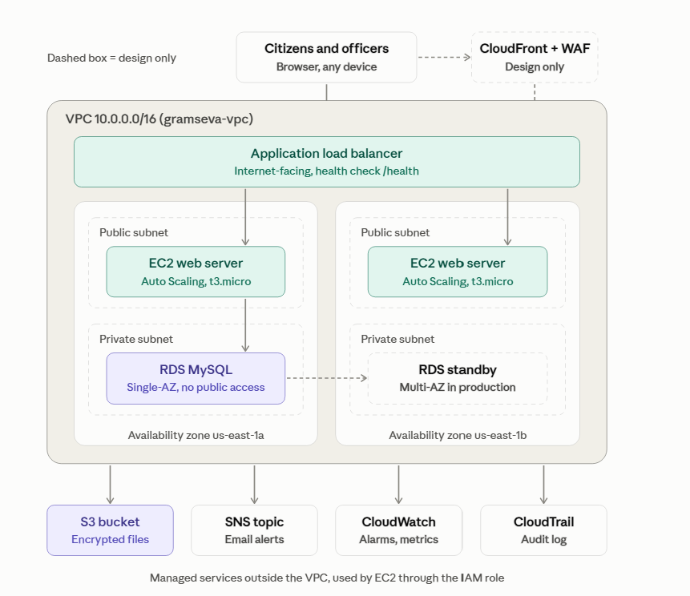

# Gram Seva Portal: Rural E-Government Portal on AWS

**Student:** Yashashwi Jain
**Registration Number:** 24BCE2112

## Overview
A cloud-hosted portal where rural citizens apply for certificates and schemes, upload documents and track status, and officers approve applications. Built as a Cloud Architecture Design project on AWS.

## AWS services used
VPC, EC2, AMI and Launch Template, Application Load Balancer, Auto Scaling, RDS MySQL, S3, SNS, IAM, CloudWatch, CloudTrail, AWS Budgets.

## Architecture

Users reach an Application Load Balancer. EC2 servers in an Auto Scaling group across two Availability Zones run the Flask app. Records go to a private RDS MySQL database, documents go to an encrypted S3 bucket, and SNS sends email notifications.

## How it works
1. Citizen submits the form on the portal.
2. The document is uploaded to S3 and the record is saved in RDS.
3. SNS emails a confirmation with the application ID.
4. An officer approves or rejects from the officer page, and SNS sends a status update.

## Run notes
The app runs on EC2 (Amazon Linux 2023, Python 3). Install the packages with `pip3 install -r requirements.txt`, set the database values at the top of `app.py`, and start it with `python3 app.py`. It needs an IAM role with access to S3 and SNS, an RDS MySQL database with an `applications` table, an S3 bucket and an SNS topic.

## Screenshots
See the `images` folder.

## Limitations
Prototype only: no officer login, HTTP instead of HTTPS, and a single-AZ database. See the report for the production design.
